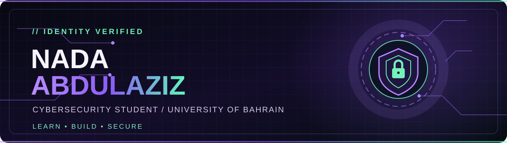

 

 

---

### `01 / WHO AM I?` 

I'm **Nada Abdulaziz**, a Cybersecurity student at the **University of Bahrain**. I'm curious about what happens behind the screen — how systems work, where vulnerabilities emerge, and how smarter security can make a difference.

I love turning what I learn into practical projects and exploring the intersection of **security, technology, and innovation**.

> **“I’m not just learning technology — I’m learning how to protect it.”**

### `02 / MY CYBER UNIVERSE`

### `03 / TECH TOOLKIT`

### `04 / WHAT I'M BUILDING`

| Project | What it explores |
| :--- | :--- |
| **RiskNet** | Cybersecurity risk analysis, actionable recommendations and business impact for SMEs |
| **HAB-GUARD** | Cyber-trusted early warning for desalination plants using satellite-derived indicators |

Academic and prototype work — explore my repositories as they become available.

### `05 / GITHUB SIGNALS`

✨ A little more about my mindset

 

**Curiosity fuels learning. Practice builds confidence. Security is a responsibility.**

My goal is to keep asking better questions, tackling meaningful challenges, and growing into a cybersecurity professional who creates real impact.

---

**[Explore my GitHub](https://github.com/nada-abdulaziz)**

Designed with curiosity, powered by purpose. 💜

